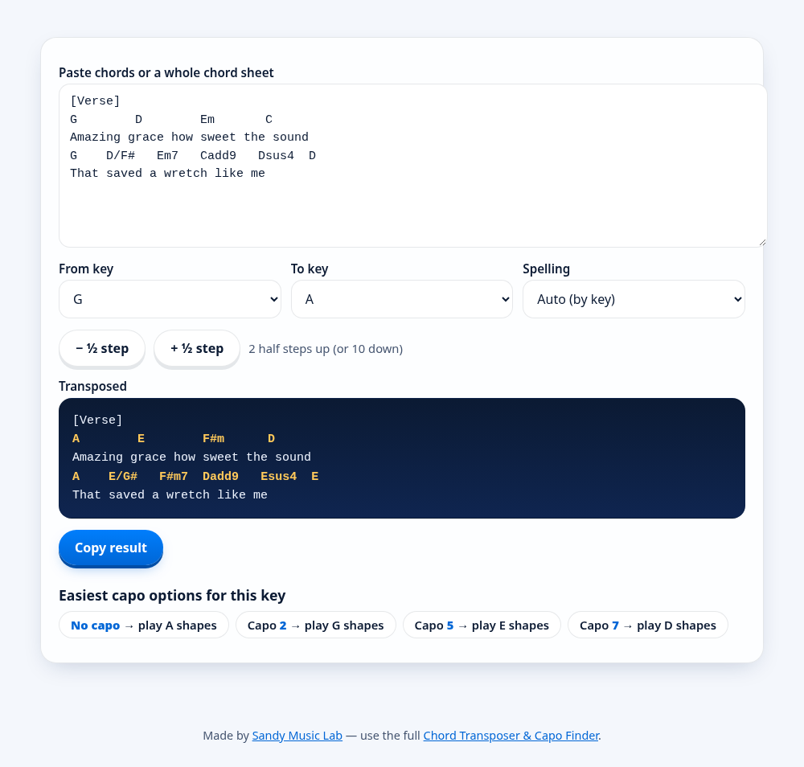
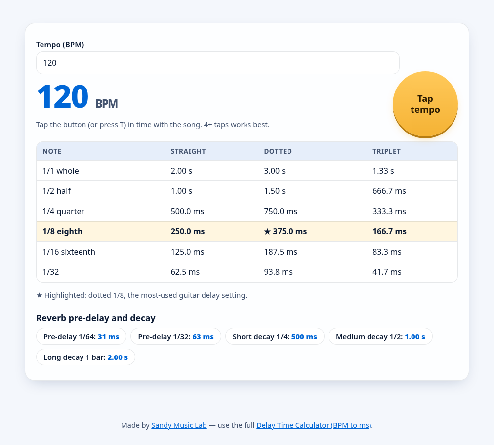
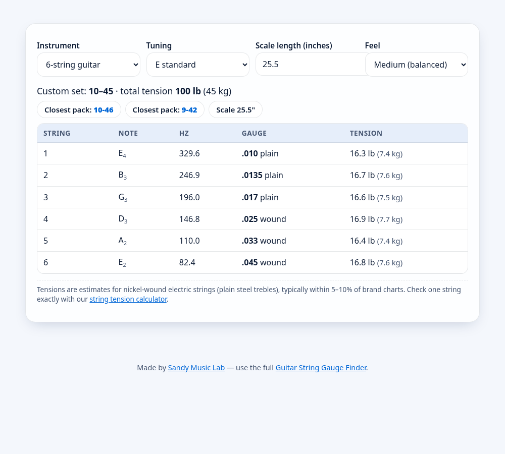
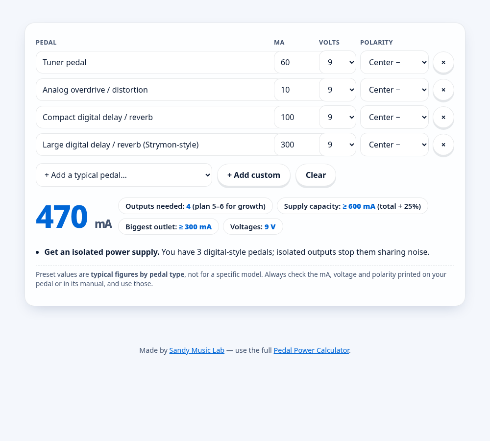

# 🎸 Sandy Music Lab Tools

Free, dependency-free **vanilla JavaScript guitar & music tools**: a chord transposer, delay time calculator, string gauge finder and pedal power calculator. Each one is a single HTML snippet with one CSS file and one JS file. There's no build step and no framework, and they work in light and dark mode.

**▶ Use the live tools:** [sandymusiclab.com/tools](https://sandymusiclab.com/tools/)

| Tool | What it does | Live demo |
|---|---|---|
| **Chord Transposer & Capo Finder** | Transpose a chord sheet to any key, with sharps/flats spelling and capo suggestions | [Open tool](https://sandymusiclab.com/tools/chord-transposer/) |
| **Delay Time Calculator** | BPM to milliseconds for straight, dotted and triplet notes, with tap tempo | [Open tool](https://sandymusiclab.com/tools/delay-time-calculator/) |
| **String Gauge Finder** | Recommends gauges and estimated tension for 25+ tunings, scale lengths, 6/7/8-string and bass | [Open tool](https://sandymusiclab.com/tools/string-gauge-finder/) |
| **Pedal Power Calculator** | Totals pedal mA, voltage and polarity and sizes your pedalboard power supply | [Open tool](https://sandymusiclab.com/tools/pedal-power-calculator/) |

## Screenshots

| Chord Transposer | Delay Time Calculator |
|---|---|
|  |  |
| **String Gauge Finder** | **Pedal Power Calculator** |
|  |  |

## Embed a tool on your site (easiest)

Paste an iframe. The `?embed=1` view is ad-free and sized for embedding:

```html
<iframe src="https://sandymusiclab.com/tools/chord-transposer/?embed=1" width="100%" height="620" style="border:0;max-width:900px" loading="lazy" title="Chord Transposer"></iframe>
<p><a href="https://sandymusiclab.com/tools/chord-transposer/">Chord Transposer</a> by Sandy Music Lab</p>
```

Swap `chord-transposer` for `delay-time-calculator`, `string-gauge-finder` or `pedal-power-calculator`.

## Self-host the source

```
tools/<tool>/index.html   markup (the <div class="smlt"> block)
tools/<tool>/style.css    shared styles (light + dark via [data-theme=dark] on <html>)
tools/<tool>/script.js    tool logic + hover effects
```

Copy the three files, or paste the `.smlt` block plus the CSS and JS into your page. Dark mode turns on when `<html data-theme="dark">` is set.

## Credit

The code is MIT licensed, so you can use it freely. If you use it on a public page, a credit link back is appreciated:

```html
Tool by <a href="https://sandymusiclab.com/tools/">Sandy Music Lab</a>
```

---

Made by **David Sandy**, the guitarist and songwriter behind [Sandy Music Lab](https://sandymusiclab.com/), where you'll find gear guides, lessons and the [Songwriter Suite](https://sandymusiclab.com/songwriter-suite/) app.
